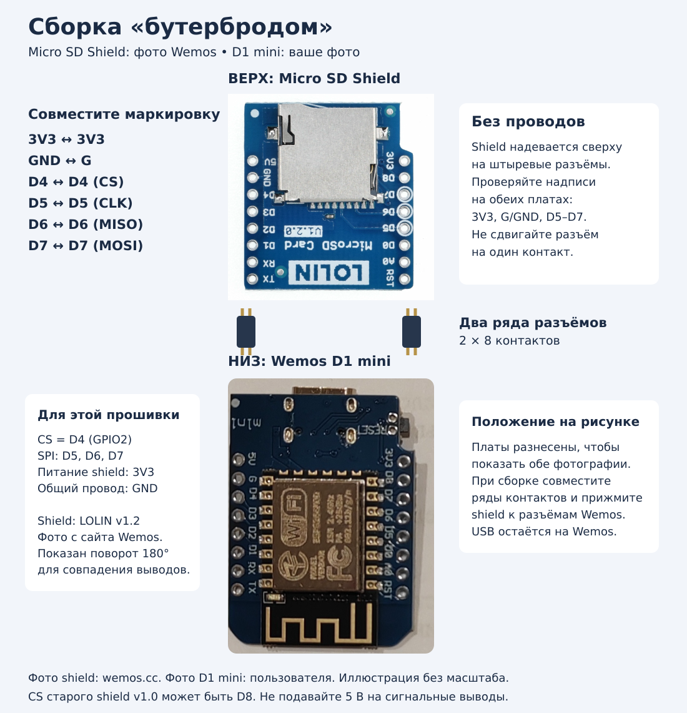

# ESP8266-SD-datalogger-for-anenji-hybrid-inverter

ESP8266-based SD card datalogger for ANENJI hybrid solar inverters with Modbus monitoring, web dashboard, energy statistics and historical charts.

## Назначение

Прошивка Arduino IDE для ESP8266 / Wemos D1 mini. Контролирует сеть, PV, нагрузку и батарею, показывает режим, аварии и предупреждения. Веб-интерфейс содержит текущие показатели, график мощности за сутки и историю энергии по часам, дням, месяцам и за выбранный год.

## Установка

1. Установите в Arduino IDE пакет плат ESP8266 и выберите Wemos D1 mini либо соответствующую плату с обозначениями D4–D7. ESP32 не поддерживается этим кодом.
2. Откройте `ANENJI_Dataloger/ANENJI_Dataloger.ino`. Оба заголовка должны находиться рядом со скетчем. Используются Arduino, ESP8266WiFi, ESP8266WebServer, WiFiUdp, EEPROM, SPI, SD и системное время; сторонняя библиотека Modbus не нужна.
3. Подключите SD-модуль для логики 3,3 В: CS → D4/GPIO2, SCK → D5/GPIO14, MISO → D6/GPIO12, MOSI → D7/GPIO13, GND → GND. GPIO2 должен оставаться высоким при загрузке; питание модуля выбирайте по его спецификации. Используйте FAT16/FAT32.
4. Загрузите прошивку. Монитор порта: 115200 бод.
5. Без сохранённого SSID устройство сразу создаёт сеть `Anenji-setup`, пароль `12345678`. Откройте `http://192.168.4.1/settings`, задайте свою сеть, пароль и IPv4 Wi-Fi-модуля инвертора. После сохранения устройство перезагрузится.
6. Откройте IP ESP8266 из монитора порта. Настройки доступны по `/settings`.

Домашние SSID и пароль удалены из исходников. При обновлении прошивки действующие настройки EEPROM сохраняются; поменяйте их через веб-страницу. Пароль точки настройки остаётся указанным выше и не является паролем домашней сети.

По умолчанию: IP инвертора `192.168.0.148`, опрос 30 секунд, обновление страницы 5 секунд, UTC+5. Wi-Fi работает на 2,4 ГГц. Для корректной истории необходима синхронизация NTP (`pool.ntp.org`, `time.nist.gov`).

## Схема подключения SD Card Shield

Shield устанавливается **сверху на Wemos D1 mini** через два ряда межплатных разъёмов по 8 контактов. Соединительные провода не нужны. На иллюстрации платы разнесены для наглядности; перед установкой совместите одноимённые выводы, особенно 3V3 и G/GND. Фото shield повёрнуто на 180° относительно оригинала для совпадения ориентации выводов.

Фото shield взято из [официальной документации Wemos](https://www.wemos.cc/en/latest/d1_mini_shield/micro_sd.html), [оригинал фотографии](https://docs.wemos.cc/en/latest/_images/sd_v1.2.0_1_16x16.jpg). Фото Wemos D1 mini предоставлено владельцем проекта. Фотографии встроены в SVG; внешняя загрузка для отображения не требуется.

[Электрическая схема соединений](docs/wemos-d1-mini-sd-wiring.svg).

Схема соответствует `SD_CS_PIN=D4` в прошивке. Монтажная иллюстрация выполнена без масштаба: подключайте по обозначениям на платах.

| Wemos D1 mini | GPIO | Micro SD Shield |
| --- | --- | --- |
| 3V3 | — | 3V3 |
| G / GND | — | G / GND |
| D4 | 2 | CS |
| D5 | 14 | CLK / SCK |
| D6 | 12 | MISO / DO |
| D7 | 13 | MOSI / DI |

При установке shield на разъёмы D1 mini совместите маркировку питания и выводов. Для LOLIN Micro SD Shield v1.2 по умолчанию используется CS=D4. Старый Wemos Micro SD Shield v1.0 использует CS=D8: для него задайте `SD_CS_PIN=D8` в скетче; если ваша плата позволяет выбрать CS, установите D4 для текущей прошивки. D8 соответствует GPIO15.

Источник: [официальный пример Wemos для Micro SD Shield](https://github.com/wemos/D1_mini_Examples/blob/master/examples/04.Shields/Micro_SD_Shield/ReadWrite/ReadWrite.ino). На [странице shield](https://www.wemos.cc/en/latest/d1_mini_shield/micro_sd.html) GPIO для D4 ошибочно указан как 0; в ESP8266 D1 mini D4 — GPIO2.

Схема относится к shield для D1 mini с питанием 3,3 В. У отдельных SD-модулей с регулятором питание может отличаться. На сигнальные выводы ESP8266 нельзя подавать 5 В; GPIO2 (D4) должен оставаться HIGH при запуске.

## Язык интерфейса EN/RU

Кнопки **EN / RU** находятся вверху главной панели. Переключение переводит подписи устройств, мощности и энергии, графики и их единицы, легенды, кнопки истории, подсказки, статусы, режим работы, аварии и предупреждения. Страница настроек, сообщения проверки и сохранения также используют выбранный язык; отдельный выбор языка в настройках удалён.

Язык записывается в существующую запись настроек EEPROM с CRC16. Изменение языка не перезагружает ESP8266, не меняет сетевые настройки и не сбрасывает текущий интервал энергии. Повторный выбор активного языка не выполняет запись. При ошибке сохранения интерфейс остаётся на прежнем языке и показывает сообщение об ошибке. После включения восстанавливается сохранённый язык. Сохранение Wi-Fi и других настроек по-прежнему требует перезагрузки.

Сервер возвращает переведённые сохранённые коды диагностики сразу при переключении языка; ждать очередного чтения регистров не требуется. При открытии страницы настроек она формируется на текущем языке.

## Связь с инвертором

ESP8266 отправляет Wi-Fi-модулю команду `set>server=<ESP_IP>:8899;` по UDP на порт 58899. Затем ожидает входящее TCP-соединение на порту 8899. По этому соединению передаются восьмибайтовые запросы Modbus RTU с CRC16: адрес устройства 1, функция 3, диапазоны 100–101, 108–109 и 201–234. Это RTU-кадры поверх TCP, без MBAP-заголовка Modbus TCP.

Совместимость зависит от Wi-Fi-модуля и карты регистров конкретного инвертора. Команда меняет адрес сервера Wi-Fi-модуля и может повлиять на его облачное подключение.

## Хранение и расчёт

Мощность интегрируется методом трапеций в пятиминутные интервалы по пяти каналам: сеть, PV, нагрузка, заряд, разряд. Положительная мощность батареи трактуется как заряд, отрицательная как разряд; отрицательная мощность сети и PV не учитывается.

SD хранит суточные файлы `/YYYYMMDD.CSV` без заголовка. Столбцы: `slot,gridWh,pvWh,loadWh,chargeWh,dischargeWh,crc`. `slot` — номер интервала Unix-времени длительностью 300 секунд. Энергия округляется до целых Вт·ч, максимум 65535 на канал за интервал. CRC16 вычисляется по бинарным полям записи, а не по тексту CSV. Повторные строки интервала допустимы: при чтении используется последняя корректная запись.

EEPROM эмулируется во flash: 4096 байт, 256 для настроек и 240 записей по 16 байт для истории. Резерв составляет до 20 часов последовательных пятиминутных интервалов; более старые записи перезаписываются. SD проверяется каждые 15 секунд, резерв переносится с проверкой записи. Суточный график восстанавливает среднюю мощность из энергии как Wh × 12.

## Файлы и HTTP API

| Файл | Роль |
| --- | --- |
| ANENJI_Dataloger.ino | Wi-Fi, протокол, время, расчёт энергии, EEPROM, SD |
| Registers.h | Адреса, масштабы, типы регистров и расшифровка диагностики |
| web_server.h | Встроенные HTML/CSS/JavaScript, настройки и JSON API |

| Маршрут | Назначение |
| --- | --- |
| GET / | Панель; в режиме настройки перенаправление |
| GET /settings | Настройки |
| POST /save | Сохранить настройки и перезагрузить |
| GET /api/live | Текущие измерения; поля энергии относятся к текущему часу |
| GET /api/samples | Завершённые интервалы текущего дня |
| GET /api/today | Энергия за текущий день |
| GET /api/history | История: scale=hour/day/month/year, year, month, day |
| GET /api/interval | Интервал обновления в миллисекундах |
| GET /api/language | Текущий язык: en / ru |
| POST /api/language | Поле language=en/ru; сохранить язык без перезагрузки, вернуть переведённые текущие данные |

## Ограничения, найденные при разборе

- HTTP не имеет авторизации и TLS; страница настроек включает сохранённый пароль Wi-Fi в HTML. Используйте только доверенную локальную сеть.
- История зависит от NTP и фиксированного смещения UTC; автоматического перехода на летнее время нет.
- Текущий незавершённый интервал находится в RAM и может потеряться при внезапном отключении питания.
- Резерв EEPROM ограничен и частые commit изнашивают flash.
- Просмотр годовой истории читает множество файлов синхронно и может замедлять опрос.
- Интерфейс полностью поддерживает EN/RU. Переключатель находится вверху панели; язык сохраняется в EEPROM без перезагрузки. Страница настроек использует выбранный язык и не содержит отдельного выбора языка.
- В исходнике сообщение загрузки называло CS=D8, хотя использовался D4. Сообщение исправлено, подключение оставлено D4.

Проверка: логика EN/RU проверена JavaScript-тестами и C++-тестами с имитацией Arduino/EEPROM: перевод, валидация языка, повторный выбор, ошибка сохранения, CRC и сохранность остальных настроек и области истории. Это не заменяет сборку под ESP8266. Arduino CLI и пакет ESP8266 в среде отсутствуют; полная сборка прошивки и испытания на устройстве не выполнены. Лицензия автором пока не выбрана.
